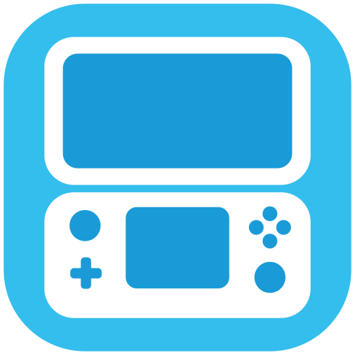
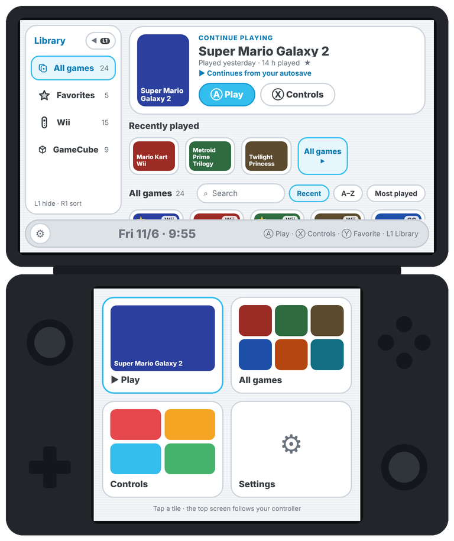
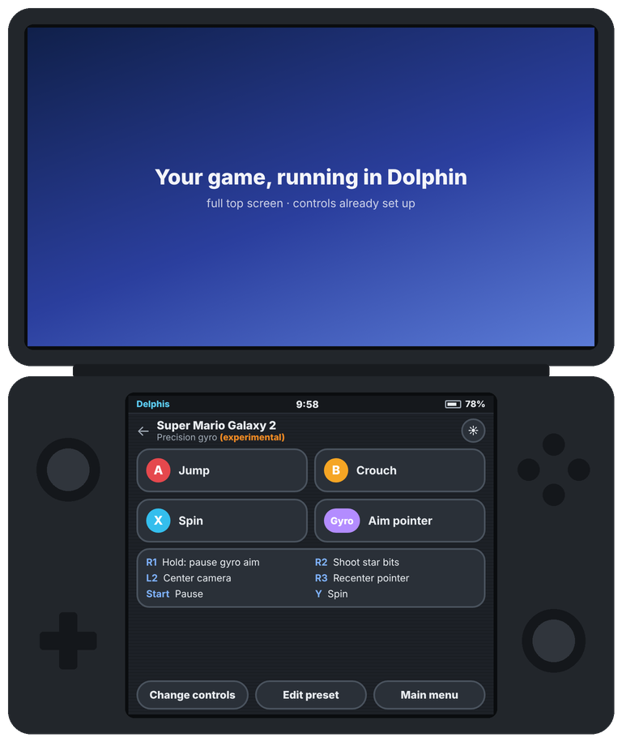
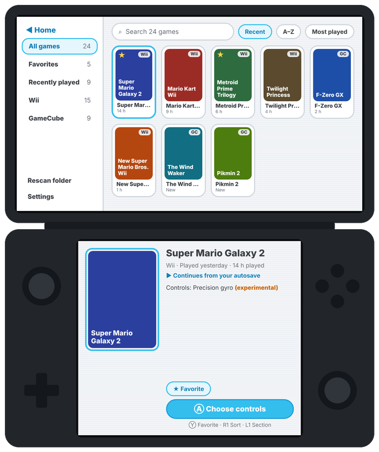
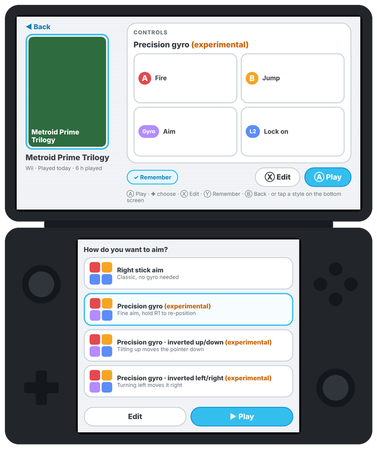
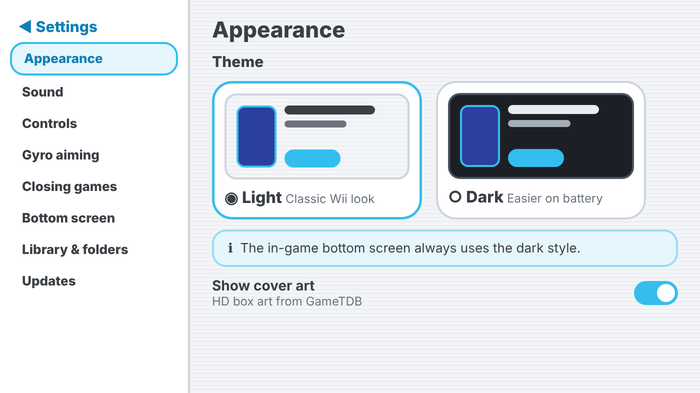

<p align="center"></p>

<h1 align="center">Delphis</h1>

<p align="center"><b>Automatic controller setup for the Dolphin emulator on dual-screen handhelds like the AYN Thor.</b></p>

Pick a game and Delphis sets up the controls that suit it (pointer, sideways Wii Remote, wheel, gyro aiming…), launches it in Dolphin on the top screen, and turns the bottom screen into a live guide to your buttons. It lets you change controls mid-game, autosaves when you quit and picks up where you left off.

<p align="center">
  
  
</p>
<p align="center">
  
  
</p>
<p align="center"><sub>Illustrations of the app's screens. In the app, the coloured boxes are replaced by real cover art.</sub></p>

## Features

### Controls that fit each game
* **Game-aware presets.** Delphis reads the game ID from the disc and suggests layouts built for that game:
  * **Super Mario Galaxy 1 & 2:** pointer on the right stick or gyro, spin on buttons, no waggling.
  * **Mario Kart Wii:** Wii Remote + Nunchuk, Wii Wheel on the stick, or Wii Wheel by tilting the Thor.
  * **New Super Mario Bros. Wii:** the Wii Remote held sideways.
  * **Metroid Prime 3 / Trilogy, Twilight Princess, Donkey Kong Country Returns, Kirby's Return to Dream Land, Super Paper Mario, Smash Bros. Brawl**, plus generic presets for everything else (pointer, sideways, Classic Controller, GameCube).
* **Gyro aiming (Experimental).** Aim the Wii pointer by moving the Thor, with two styles: *Gyro aiming* and *Precision gyro*, which moves finely when you move slowly and far when you move fast, and lets you hold R1 to freeze the pointer and re-position (like lifting a mouse). Invert up/down or left/right in Settings, and try it all on the built-in test screen.
* **Edit any preset.** Change what any button does for one game; your version is saved for that game.
* **Change controls mid-game.** Pick another layout from the bottom screen; the game restarts with it and, with autosave on, continues from the same spot.

### Two screens, used properly
* **Top screen:** Delphis' menus, then the game in Dolphin.
* **Bottom screen in the menus:** quick tiles, a touch picker for control styles, and details for the game you're on.
* **Bottom screen while playing:** big tiles for the main buttons (colour-coded A, B, X, Y), the rest in a short list, plus *Change controls*, *Edit preset* and *Main menu*. A thin bar shows the time and battery.
* **It dims itself** after a few seconds to save battery. Touch it to light it up; it dims again 1.5 s after you stop. It never takes the controller away from Dolphin.

### Autosave and resume
* When you close a game from Delphis, it saves a Dolphin save state first, and the next time you start that game from Delphis, it continues from there. You can turn this off in *Settings → Closing games*.

### A Wii-style home
* **One scrolling home:** a **Continue playing** card for your last game, a recently played row, then your whole library, with a retractable column for All games, Favorites, Wii and GameCube, plus search and sorting by Recent / A–Z / Most played.
* **Proper game names** from Delphis' game database and GameTDB, and an illustration for each control style (Wii Remote + Nunchuk, sideways, Wii Wheel, Classic, GameCube, gyro).
* **Menus work with the D-pad:** when nothing is moving the Wii pointer, Delphis hides it so it can't sit in the middle of the screen and take over menu selection.
* **What's new card:** after an update, Delphis shows the changes once.
* **Play time** and **last played** for every game, and HD cover art from GameTDB.
* **Light (classic Wii) or Dark theme.** The in-game bottom screen is always dark.
* **Menu music:** an original, Wii-style loop that plays only in the menus, or your own audio file, with its own volume slider.
* A **first-run walkthrough**, controller hints on every screen, and full controller navigation.

<p align="center"></p>

### Behind the scenes
* **Clean game closing.** An optional accessibility helper presses Dolphin's own *Exit Emulation* so the next game starts cleanly (Android on the Thor won't let other apps force-close Dolphin). It never reads or changes your controller input.
* **Controller Check and Diagnostics** to record exactly what each Thor button sends, watch live inputs, and copy a report if something doesn't respond, including crash logs.
* **In-app updates** from this repository's releases.
* **Light on the battery:** no polling during games, the lowest refresh rate on the bottom screen, and music and sensors only when they're needed.

## Install

1. Download **Delphis.apk** from the [latest release](../../releases/tag/latest) and install it on your Thor. Android asks you to allow installing apps from your browser or file manager the first time.
2. Open Dolphin once so its user folder exists.
3. Open Delphis and follow the walkthrough:
   1. **Connect Dolphin's folder:** in the picker, open *Dolphin* in the side menu and tap *Use this folder*.
   2. **Choose your games folder.**
   3. **Turn on "close games"** (the accessibility helper).
   4. **Controller Check** (recommended, about a minute).
   5. Optionally **try gyro aiming**.

After that, Delphis updates itself: *Settings → Updates* (it also checks quietly at start-up).

## How it works

| What | How |
|---|---|
| Identify the game | Reads the 6-character game ID from the disc header of `.iso/.gcm`, `.rvz/.wia`, `.wbfs` and `.ciso` files (falls back to the file name). |
| Apply a preset | Writes a controller profile to `Config/Profiles/Wiimote/` (or `GCPad/`) and sets `[Controls] WiimoteProfile1 = …` in `GameSettings/<GAMEID>.ini`: Dolphin's own per-game profile setting, so other games and your other settings are untouched. |
| Gyro aiming | Built from Dolphin's input expressions (`relative()`, `atan2`, variables) using the Thor's gyroscope and accelerometer; no extra app or root. |
| Reach Dolphin's files | Dolphin's built-in DocumentsProvider ("Dolphin" in the system folder picker). You grant access once; no root needed. |
| Launch | The same intent frontends like ES-DE use (`AutoStartFile`), started on the top display. |
| Bottom screen | A non-focusable window on the second display, so the controller always stays with Dolphin. |
| Close / save / resume | The accessibility helper presses Dolphin's in-game menu buttons (*Quick Save*, *Quick Load*, *Exit Emulation*). |

Input names and profile keys were checked against Dolphin's source.

## Build

You need Android Studio (Ladybug or newer) or JDK 17 + Gradle 8.9+.

```
gradle :app:assembleDebug        # or open the folder in Android Studio and press Run
gradle :app:testDebugUnitTest    # core logic tests
```

Every push builds the APKs on GitHub Actions; pushes to `main` publish them to the `latest` release.

**Signing:** builds are signed with `signing/release.jks` so updates install over each other. This key is in the public repository, so anyone could sign an APK Android would accept as an update. Before sharing the app widely, move the key into GitHub secrets: the build reads `SIGNING_KEYSTORE_PATH`, `SIGNING_STORE_PASSWORD`, `SIGNING_KEY_ALIAS` and `SIGNING_KEY_PASSWORD` when they're set.

## Adding a game

Add a `GameRule` in `core/GameDatabase.kt`, using the first three characters of the game ID. If none of the existing presets fit, add one in `core/Presets.kt` with the small DSL there:

```kotlin
button(ThorControl.R1, "Spin (shake)", "Shake/X", "Shake/Y", "Shake/Z")
directional(ThorControl.RIGHT_STICK, "Pointer", "IR")
option("Options/Sideways Wiimote", "True")
```

## Project layout

```
core/       pure Kotlin (unit-tested): disc header reader, presets, game database, gyro maths, INI writer
platform/   Android glue: Dolphin folder access, launching, closing/autosave helper, updates, prefs, music
ui/         Jetpack Compose: home and library, game page, settings, walkthrough, in-game bottom screen
tools/      menu-music generator and the HTML sources of the README illustrations
```

---

Delphis is an independent project. It isn't affiliated with or endorsed by the Dolphin Emulator project, Nintendo or AYN. Wii and GameCube are trademarks of Nintendo.
